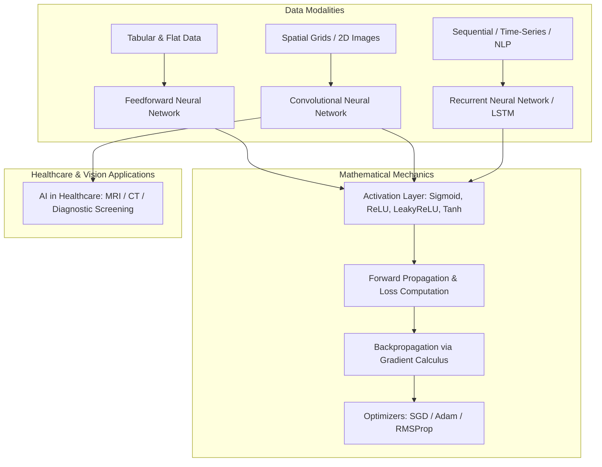

<div align="center">


[](https://www.python.org/)
[](https://numpy.org/)
[](https://matplotlib.org/)
[](https://jupyter.org/)
[](#)
[](#)

</div>

---

## 📌 Executive Summary / Overview

The **Deep Learning Architectures & Research** repository encompasses an academic and practical exploration of deep neural network architectures, non-linear activation mechanics, and healthcare artificial intelligence conducted at the Department of Computer Applications, Alliance University.

The repository investigates three foundational neural paradigms:
1. **Feedforward Neural Networks (FNN)**: Fully connected multi-layer perceptrons modeling tabular and static mappings.
2. **Convolutional Neural Networks (CNN)**: Spatial feature extraction hierarchies leveraging parameter sharing and translational invariance for computer vision.
3. **Recurrent Neural Networks (RNN / LSTM / GRU)**: Sequential temporal dynamics with gated memory units mitigating vanishing gradient phenomena.

Furthermore, this repository provides analytical implementations of non-linear activation functions (`Sigmoid`, `Tanh`, `ReLU`, `LeakyReLU`), backpropagation gradient derivations, and clinical AI case studies focusing on computer vision diagnostics in medical imaging.

---

## 📖 Interactive Table of Contents

- [Executive Summary / Overview](#-executive-summary--overview)
- [Key Features & Capabilities](#-key-features--capabilities)
- [System Architecture & Theoretical Framework](#-system-architecture--theoretical-framework)
- [Tech Stack Breakdown](#-tech-stack-breakdown)
- [Research Topics & Implementation Modules](#-research-topics--implementation-modules)
- [Reproducible Quickstart & Setup](#-reproducible-quickstart--setup)
- [Project Directory Layout](#-project-directory-layout)
- [Author & Contributions](#-author--contributions)

---

## ✨ Key Features & Capabilities

- **Mathematical Activation Benchmark (`Project_5 (1).ipynb`)**: Vectorized implementations and continuous visualization ($x \in [-5, 5]$) of Sigmoid, ReLU, LeakyReLU, and Tanh functions, analyzing saturation zones and vanishing gradients.
- **Architectural Benchmark Study (`Assignment 3 DL.docx`)**: Detailed comparative analysis examining receptive fields, spatial pooling, recurrence gating, parameter efficiency, and computational complexity across FNN, CNN, and RNN.
- **Clinical AI in Healthcare Diagnostics (`AI_in_Healthcare.pdf`)**: Synthesis of deep learning methodologies in automated radiological screening, CT/MRI anomaly detection, and clinical decision support.
- **Optimization & Backpropagation Mechanics (`DL+Assignment+2.pdf`)**: Formal treatment of loss landscape traversal, Adam/SGD convergence criteria, and weight initialization strategies (Xavier/He).
- **Hyperparameter Tuning & Regularization (`DL Assignment 4.pdf`)**: Practical methodologies covering dropout, batch normalization, and learning rate scheduling.

---

## 🏗️ System Architecture & Theoretical Framework



---

## 🛠️ Tech Stack Breakdown

| Category | Technologies & Tools |
| :--- | :--- |
| **Programming Language** | Python 3.9+ |
| **Mathematical Computing** | NumPy (Vectorized Array Operations) |
| **Plotting & Visualization** | Matplotlib, Seaborn |
| **Development Environments** | Jupyter Notebook, Google Colab |
| **Theoretical & Research Documentation** | LaTeX, Microsoft Word, Adobe PDF |

---

## 🔬 Research Topics & Implementation Modules

| File Name | Domain | Subject Matter | Key Deliverables |
| :--- | :--- | :--- | :--- |
| `Project_5 (1).ipynb` | Mathematical Modeling | Non-Linear Activation Functions | NumPy vectorization & Matplotlib curves |
| `Assignment 3 DL.docx` | Deep Learning Theory | FNN vs. CNN vs. RNN Architecture | Comprehensive architectural comparative report |
| `AI_in_Healthcare.pdf` | Applied Deep Learning | Medical Image Classification & AI Diagnostics | Clinical diagnostic use cases and methodology |
| `DL+Assignment+2.pdf` | Optimization Calculus | Backpropagation & Gradient Descent | Mathematical derivations & convergence analysis |
| `DL Assignment 4.pdf` | Deep Learning Systems | Hyperparameter Tuning & Regularization | Practical tuning strategies and performance evaluation |

---

## 🚀 Reproducible Quickstart & Setup

### Prerequisites
- Python 3.9 or higher
- Jupyter Notebook / Jupyter Lab

### Installation
```bash
# Clone the repository
git clone https://github.com/Jeshwanthika07/DL-Assignments.git
cd DL-Assignments

# Create and activate a virtual environment
python -m venv venv
# On Windows:
.\venv\Scripts\activate
# On Linux/macOS:
source venv/bin/activate

# Install required dependencies
pip install numpy matplotlib jupyterlab
```

### Launch the Activation Function Benchmark
```bash
jupyter lab "Project_5 (1).ipynb"
```

---

## 📂 Project Directory Layout

```text
DL-Assignments/
│
├── Project_5 (1).ipynb      # NumPy vectorized activation function benchmarking
├── Assignment 3 DL.docx     # Comparative study: FNN, CNN, and RNN paradigms
├── AI_in_Healthcare.pdf     # Research report on deep learning in clinical healthcare
├── DL Assignment 4.pdf      # Practical deep learning exercises and regularization
├── DL+Assignment+2.pdf      # Mathematical foundations of backpropagation & loss curves
└── README.md                # Comprehensive documentation and study guide
```

---

## 👩‍💻 Author & Contributions

Authored and researched by **[Jeshwanthika Pothamchetty](https://github.com/Jeshwanthika07)**  
*Bachelor of Computer Applications | Department of Computer Applications, Alliance University*

<div align="center">


</div>
